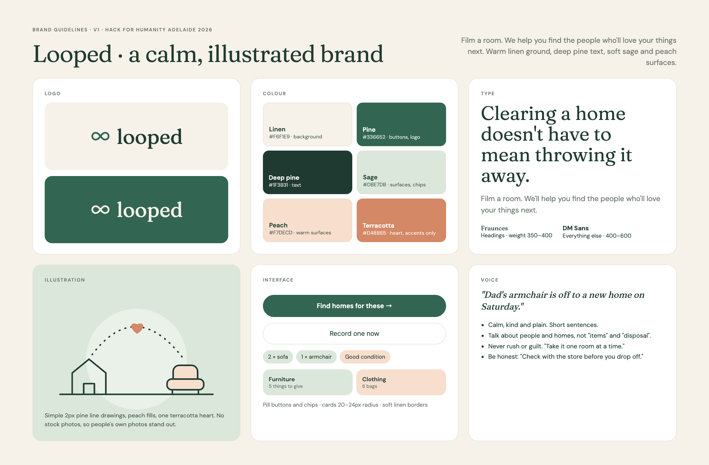

# Looped brand guide

**Looped** helps people who are moving out, or clearing a loved one's home, find the people who'll
love their things next. The brand is calm, warm and illustrated: it should feel like a kind
friend helping you sort a room, not a recycling company.

- **Name:** looped (lowercase in the logo, "Looped" in sentences)
- **Tagline:** Clearing a home doesn't have to mean throwing it away.
- **One-liner:** Film a room. We'll help you find the people who'll love your things next.
- **Short line:** Keep it in the loop.

## Logo

The mark is a soft infinity loop: things going round to the next person. It sits to the left
of the wordmark "looped" set in Fraunces.

| File | Use |
| --- | --- |
| [brand/looped-mark.svg](brand/looped-mark.svg) | Pine mark on linen or white |
| [brand/looped-mark-white.svg](brand/looped-mark-white.svg) | Linen mark on pine |
| [brand/looped-illustration.svg](brand/looped-illustration.svg) | The house, armchair and heart illustration |
| [brand/looped-brand-guide.png](brand/looped-brand-guide.png) | This guide as one image (1920×1260) |

Give the logo space around it equal to the height of the mark. Don't stretch, outline, shadow or
recolour it outside the palette.

## Colour

| Name | Hex | RGB | Use |
| --- | --- | --- | --- |
| Linen | `#F6F1E9` | 246, 241, 233 | Background, almost everywhere |
| White | `#FFFFFF` | 255, 255, 255 | Cards |
| Deep pine | `#1F3B31` | 31, 59, 49 | Headings and body text |
| Pine | `#336652` | 51, 102, 82 | Buttons, logo, links |
| Sage | `#DBE7DB` | 219, 231, 219 | Surfaces, chips, illustration panels |
| Peach | `#F7DECD` | 247, 222, 205 | Warm surfaces, highlights, Gemma's summary |
| Terracotta | `#D48865` | 212, 136, 101 | The heart and tiny accents only |
| Taupe | `#D6CCBF` | 214, 204, 191 | Camera frame, photo placeholders |
| Muted text | `#6B776F` | 107, 119, 111 | Captions and helper text |
| Border | `#E6DFD4` | 230, 223, 212 | Soft card borders |

Mostly linen and white, with sage and peach as soft blocks. Pine is for the one important action
on a screen. Terracotta is a spice: one heart, never a background.

## Type

| Role | Font | Weight | Notes |
| --- | --- | --- | --- |
| Headings | [Fraunces](https://fonts.google.com/specimen/Fraunces) | 350–400 | Soft serif, sentence case, never bold |
| Everything else | [DM Sans](https://fonts.google.com/specimen/DM+Sans) | 400 body, 600 labels and buttons | |

Both are free Google Fonts. Use sentence case everywhere.

## Illustration and imagery

- Simple line drawings: 2px deep pine strokes, round ends, with peach or sage fills.
- One terracotta heart travelling along a dotted arc means "passed on".
- No stock photos. The only photos are people's own rooms and things.

## Voice

- Calm, kind and plain. Short sentences.
- Talk about people and homes, not "items", "assets" or "disposal".
- Never rush or guilt. "Take it one room at a time."
- Be honest about limits. "Check with the store before you drop off."
- Example: "Dad's armchair is off to a new home on Saturday."

## For videos

- **Formats:** 9:16 (1080×1920) for social and phone demos, 16:9 (1920×1080) for the pitch.
- **Look:** linen backgrounds, white or sage cards, pine text. Phone screens from the app at
  390×844, on a linen background with soft shadows.
- **Motion:** slow and gentle. Ease-in-out, 400–700 ms moves, fades and soft slides. No fast
  cuts, glitches, zoom punches or neon.
- **Signature move:** the terracotta heart travels along the dotted arc from the house to the
  armchair.
- **Pacing:** one idea per scene, 3–5 seconds each. 30 to 45 seconds in total.
- **Music:** warm acoustic or soft piano, no drops.
- **Type on screen:** Fraunces for big lines, DM Sans for captions. Keep lines under 8 words.
- **End card:** the logo on linen, "Clearing a home doesn't have to mean throwing it away.",
  then the app link.

**Story for a 30-second video:**
1. A full room and a moving box. "Moving out?"
2. Someone films the room on their phone. "Film a room."
3. The item list appears as sage and peach piles. "Gemma sees what's there."
4. Charity cards fill in. "We find who'll love it next."
5. The heart travels along the arc. "Keep it in the loop."
6. End card with the logo and link.

**Prompt starter for AI video tools:**

> Calm, warm, illustrated style. Warm linen background (#F6F1E9), deep pine green text and line
> drawings (#1F3B31, #336652), soft sage (#DBE7DB) and peach (#F7DECD) shapes, one small
> terracotta heart (#D48865). Simple 2px line illustrations, no stock photos. Gentle,
> slow motion with soft fades. Serif headlines like Fraunces, clean sans captions like DM Sans.
